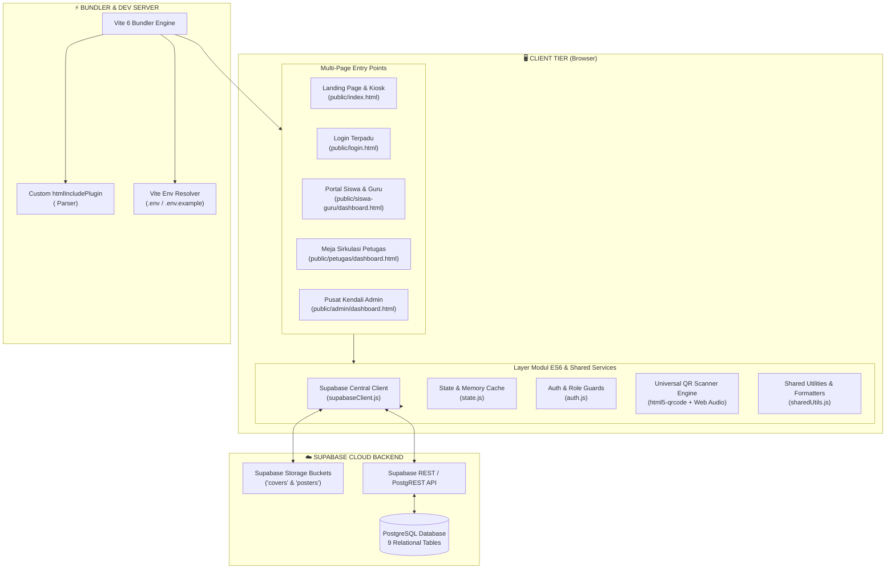
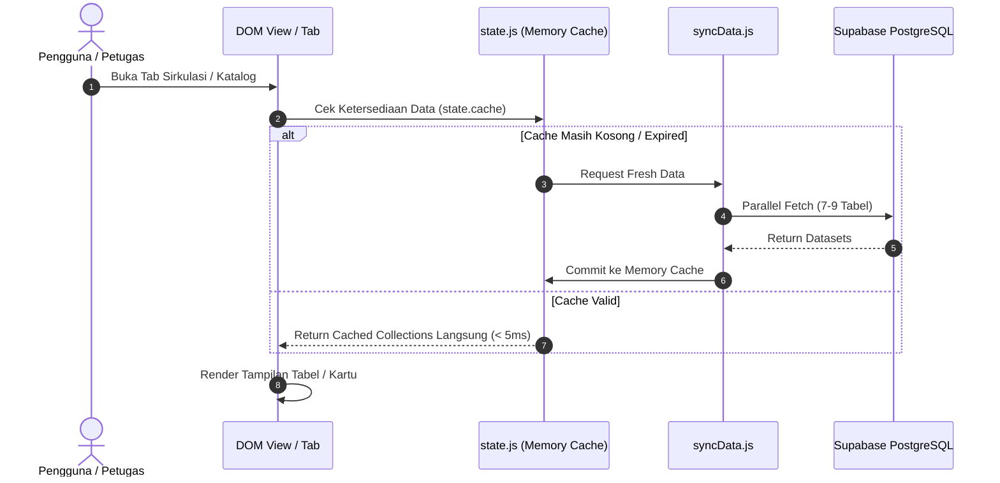
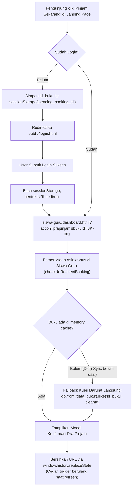

# Arsitektur Sistem — CAKRAWALA

> **Dokumen Arsitektur Perangkat Lunak, Struktur Modular, & Pola Aliran Data**  
> Proyek: **CAKRAWALA** (*Cerdas Akses Koleksi Referensi, Wujudkan Aspirasi Literasi Aksara*)  
> Arsitektur: **Vite Multi-Page Application (MPA) with Component Partials & Feature-Driven ES6 Modules**

---

## 1. Ikhtisar & Filosofi Arsitektur

Sistem otomasi perpustakaan digital **CAKRAWALA** dibangun dengan filosofi **Modern Client-Side Modular Architecture**. Pendekatan ini dipilih untuk menggabungkan kecepatan pengembangan aplikasi berbasis web statis/MPA dengan keteraturan kode (*clean code*) setara kerangka kerja modern, tanpa ketergantungan yang rumit atau *monolithic bloat*.

### Prinsip Utama Desain Sistem:
1. **Zero Monolith (< 300 Lines Rule):** Mencegah file raksasa (> 1.000 baris) dengan memecah antarmuka menjadi komponen HTML modular dan logika bisnis menjadi modul ES6 berbasis fitur (*feature-driven*).
2. **Component-Driven HTML Partials:** Menggunakan plugin kustom Vite (`htmlIncludePlugin`) untuk menyusun tampilan halaman via tag `<include src="./components/..." />`.
3. **Reactive In-Memory State Cache:** Menjaga performa aplikasi tetap instan dengan sistem caching memori multi-tabel di layer client, meminimalkan frekuensi kueri berulang ke Supabase.
4. **Single Source of Truth Database:** Seluruh operasi data tersentralisasi melalui instance Supabase PostgreSQL terkelola via SDK client resmi di `public/assets/js/supabaseClient.js`.
5. **Universal Hardware-Free Features:** Fitur pemindai kamera (Webcam) dan umpan balik suara (*beep audio*) diimplementasikan langsung menggunakan standar Web APIs murni (`navigator.mediaDevices`, `AudioContext`).

---

## 2. Diagram Arsitektur Tingkat Tinggi



---

## 3. Struktur Multi-Page Application (MPA)

Aplikasi CAKRAWALA menggunakan konfigurasi Vite Multi-Page App. Masing-masing modul pengguna memiliki titik masuk (*entry point*) HTML dan JavaScript tersendiri:

| Entry Point HTML | Koordinator Script | Peruntukan / Pengguna | Deskripsi Fungsional |
| --- | --- | --- | --- |
| `public/index.html` | `public/assets/js/main.js` | Publik / Guest / Tamu | Pencarian buku, cek stok, lokasi nomor rak fisik, kiosk anjungan mandiri, agenda kampus. |
| `public/login.html` | `public/assets/js/auth.js` | Semua Pengguna | Gerbang autentikasi terpadu berbasis username & password dengan auto-redirect sesuai role. |
| `public/siswa-guru/dashboard.html` | `public/siswa-guru/siswaGuru.js` | Siswa & Guru | Portal reservasi mandiri (pra-pinjam), pemantauan jatuh tempo, tiket QR, kartu anggota digital, rekap denda. |
| `public/petugas/dashboard.html` | `public/petugas/petugas.js` | Petugas Perpustakaan | 5 Meja Kerja terintegrasi: Overview, Sirkulasi (Walk-in & Pra-pinjam), Pengembalian & Denda, Inventaris Buku & Stiker QR, Pengumuman. |
| `public/admin/dashboard.html` | `public/admin/admin.js` | Administrator | Manajemen pengguna multi-role (Siswa, Guru, Petugas), rekapitulasi data, import massal Excel/CSV. |

---

## 4. Sistem Komponen Modular (`htmlIncludePlugin`)

Untuk menjaga agar file utama `dashboard.html` tetap bersih dan di bawah 105 baris kode, arsitektur ini menerapkan plugin rekursif pada `vite.config.js`:

```text
dashboard.html (Master Shell Layout < 100 baris)
  ├── <include src="./components/layout/header.html" />
  ├── <include src="./components/layout/sidebar.html" />
  ├── <include src="./components/tabs/tab-*.html" />
  └── <include src="./components/modals/modal-*.html" />
```

### Mekanisme Kerja Plugin:
1. **Pendeteksian Tag:** Regular expression `/<(?:include|load)\s+(?:src=)?['"]([^'"]+)['"]\s*(?:\/>|><\/(?:include|load)>)/gi` memindai referensi tag include pada HTML mentah.
2. **Pemrosesan Rekursif:** Konten berkas yang di-include dibaca dan diproses kembali (*nested inclusion*), memungkinkan komponen di dalam komponen lain.
3. **Hot Module Replacement (HMR):** File watcher Vite memicu *full reload* secara instan ke browser saat berkas `.html` di dalam `components/` diubah.
4. **Optimasi Bundling Rollup:** Saat menjalankan `npm run build`, seluruh potongan komponen digabungkan menjadi 1 file HTML utuh per entry point di folder `dist/`.

---

## 5. Pola Manajemen State & Cache Reaktif (`state.js`)

Untuk mencegah *latency overhead* dan kuota request berlebih ke Supabase, sistem menggunakan pola **In-Memory Central State Cache**:



### Karakteristik State:
- **Penyimpanan:** Objek JavaScript murni (`state = { cache: { buku: [], peminjaman: [], ... }, filters: { ... } }`).
- **Sinkronisasi Paralel:** Kueri awal dilakukan serentak menggunakan `Promise.all()` saat inisialisasi aplikasi untuk memangkas *Time to Interactive* (TTI).
- **Mutasi & Invalidasi:** Setiap kali ada aksi mutasi (tambah buku, verifikasi pinjam, bayar denda), state lokal diperbarui secara *optimistic* atau memicu sinkronisasi latar belakang parsial.

---

## 6. Alur Keandalan Booking Lintas Halaman (*Fault-Tolerant Direct Booking*)

Sistem mengadopsi mekanisme perpindahan sesi yang tahan galat saat pengunjung umum memilih buku dari katalog landing page:



---

## 7. Arsitektur Modul Pemindai Kamera Universal

Modul scanner kamera pada Meja Sirkulasi (`public/petugas/modules/scanner/`) dirancang mandiri tanpa dependensi server:

1. **Hardware Ingestion (`cameraStream.js`):** Mengakses perangkat video via `navigator.mediaDevices.getUserMedia` dengan kontrol resolusi adaptif dan switch kamera depan/belakang.
2. **Dual Recognition Engine (`index.js` & `fileDecoder.js`):**
   - Stream kamera video real-time dianalisis oleh `Html5QrcodeScanner`.
   - File tangkapan layar/unggah foto didekode oleh modul parser file.
3. **Universal Scan Router (`scanRouter.js`):**
   - Mendeteksi prefix kode tiket `PJ-...` $\rightarrow$ membuka modal verifikasi Meja 2 (Sirkulasi).
   - Mendeteksi prefix kode stiker buku `BK-...` $\rightarrow$ membuka Meja 3 (Pengembalian) atau Keranjang Walk-In tergantung tab aktif.
4. **Zero-File Audio Feedback (`soundFeedback.js`):**
   - Membangun gelombang sinus 880Hz (Not A5) selama 120ms menggunakan browser `AudioContext` untuk menghasilkan nada *beep* konfirmasi tanpa butuh file aset suara eksternal `.mp3`.

---

## 8. Keamanan & Konfigurasi Lingkungan

### Layer Keamanan Klien:
- **Client Guard Script (`auth.js`):** Setiap dashboard memvalidasi keberadaan token sesi pengguna di awal rendering. Jika token tidak ditemukan atau role tidak berhak, pengguna dialihkan ke `login.html`.
- **Environment Isolation:** Kredensial Supabase diakses melalui `import.meta.env.VITE_SUPABASE_URL` dan `import.meta.env.VITE_SUPABASE_ANON_KEY`. Tidak ada string kunci yang di-hardcode di kode program.
- **Data Protection:** Penghapusan buku atau anggota dilindungi aturan integritas referensial (Foreign Key) dan validasi bisnis (buku yang sedang dipinjam dilarang keras dihapus).

