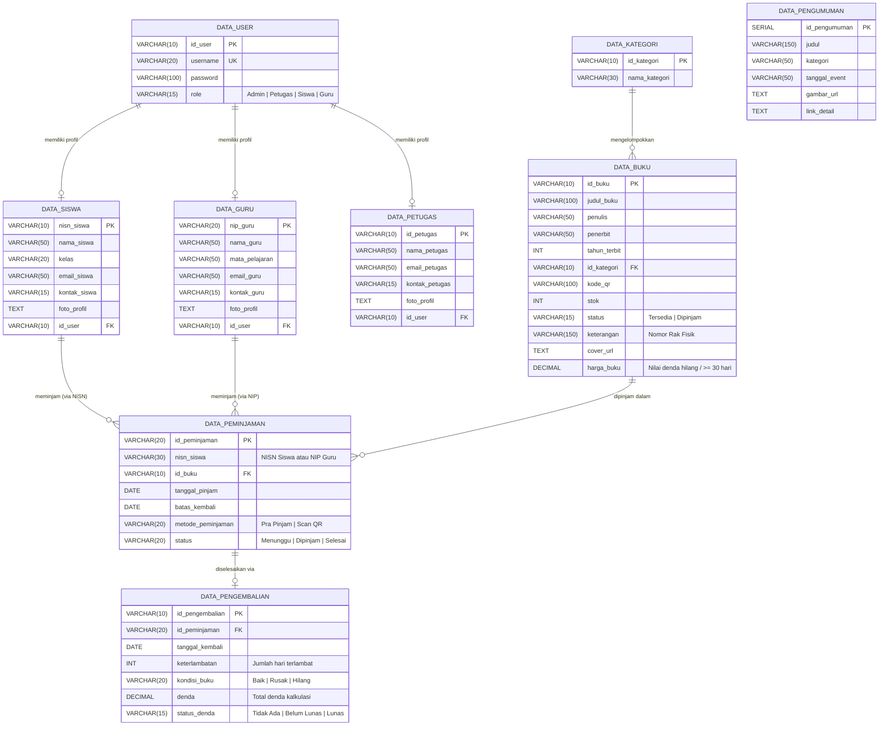

# Skema Database & Kamus Data — CAKRAWALA

> **Dokumen Spesifikasi Database Relasional PostgreSQL, Indeks Performa, Relasi ERD, & Storage**  
> Proyek: **CAKRAWALA** (*Cerdas Akses Koleksi Referensi, Wujudkan Aspirasi Literasi Aksara*)  
> Database Platform: **Supabase Cloud (PostgreSQL 15+)**

---

## 1. Diagram Relasi Entitas (ERD)



---

## 2. Kamus Data & Spesifikasi Tabel (Data Dictionary)

### 2.1. Tabel `data_user`
Menyimpan kredensial autentikasi terpadu untuk semua peran di sistem.

| Kolom | Tipe Data | Nullable | Default | Keterangan & Aturan Validasi |
| --- | --- | --- | --- | --- |
| `id_user` | `VARCHAR(10)` | NO | Primary Key | ID Pengguna unik (contoh: `USR-001`, `AD-01`). |
| `username` | `VARCHAR(20)` | NO | Unique | Username unik untuk login ke portal. |
| `password` | `VARCHAR(100)` | NO | - | Kata sandi akun. |
| `role` | `VARCHAR(15)` | NO | - | Pilihan hak akses: `'Admin'`, `'Petugas'`, `'Siswa'`, `'Guru'`. |

---

### 2.2. Tabel `data_siswa`
Menyimpan profil detail anggota kategori Siswa. Terhubung secara relasional ke `data_user`.

| Kolom | Tipe Data | Nullable | Default | Keterangan & Aturan Validasi |
| --- | --- | --- | --- | --- |
| `nisn_siswa` | `VARCHAR(10)` | NO | Primary Key | Nomor Induk Siswa Nasional (10 digit angka). |
| `nama_siswa` | `VARCHAR(50)` | NO | - | Nama lengkap siswa. |
| `kelas` | `VARCHAR(20)` | NO | - | Rombongan belajar (contoh: `X IPA 1`, `XII RPL 2`). |
| `email_siswa`| `VARCHAR(50)` | NO | - | Alamat email resmi siswa. |
| `kontak_siswa`| `VARCHAR(15)`| NO | - | Nomor WhatsApp/telepon siswa. |
| `foto_profil`| `TEXT` | YES | NULL | URL foto profil dari storage Supabase (opsional). |
| `id_user` | `VARCHAR(10)` | NO | FK | Terhubung ke `data_user(id_user)` dengan aturan `ON DELETE CASCADE`. |

---

### 2.3. Tabel `data_guru`
Menyimpan profil detail anggota kategori Guru/Tenaga Pendidik.

| Kolom | Tipe Data | Nullable | Default | Keterangan & Aturan Validasi |
| --- | --- | --- | --- | --- |
| `nip_guru` | `VARCHAR(20)` | NO | Primary Key | Nomor Induk Pegawai / NIK pengajar. |
| `nama_guru` | `VARCHAR(50)` | NO | - | Nama lengkap beserta gelar guru. |
| `mata_pelajaran`| `VARCHAR(50)`| NO | - | Bidang studi pengajaran (contoh: `Matematika`, `Fisika`). |
| `email_guru` | `VARCHAR(50)` | NO | - | Alamat email dinas/pribadi pengajar. |
| `kontak_guru`| `VARCHAR(15)` | NO | - | Nomor kontak WhatsApp guru. |
| `foto_profil`| `TEXT` | YES | NULL | URL foto profil (opsional). |
| `id_user` | `VARCHAR(10)` | NO | FK | Terhubung ke `data_user(id_user)` dengan aturan `ON DELETE CASCADE`. |

---

### 2.4. Tabel `data_petugas`
Menyimpan data staf meja sirkulasi operasional perpustakaan.

| Kolom | Tipe Data | Nullable | Default | Keterangan & Aturan Validasi |
| --- | --- | --- | --- | --- |
| `id_petugas` | `VARCHAR(10)` | NO | Primary Key | ID identitas staf perpustakaan. |
| `nama_petugas`| `VARCHAR(50)`| NO | - | Nama lengkap petugas sirkulasi. |
| `email_petugas`| `VARCHAR(50)`| NO | - | Email operasional staf. |
| `kontak_petugas`| `VARCHAR(15)`| NO | - | Nomor telepon petugas. |
| `foto_profil`| `TEXT` | YES | NULL | URL foto profil (opsional). |
| `id_user` | `VARCHAR(10)` | NO | FK | Terhubung ke `data_user(id_user)` dengan aturan `ON DELETE CASCADE`. |

---

### 2.5. Tabel `data_kategori`
Master kategori klasifikasi buku perpustakaan.

| Kolom | Tipe Data | Nullable | Default | Keterangan |
| --- | --- | --- | --- | --- |
| `id_kategori` | `VARCHAR(10)` | NO | Primary Key | ID Kategori (contoh: `KAT-001`). |
| `nama_kategori`| `VARCHAR(30)` | NO | - | Nama bidang ilmu (contoh: `Sains`, `Sastra`, `Teknologi`). |

---

### 2.6. Tabel `data_buku`
Master koleksi buku perpustakaan beserta status fisik dan referensi rak.

| Kolom | Tipe Data | Nullable | Default | Keterangan & Aturan Bisnis |
| --- | --- | --- | --- | --- |
| `id_buku` | `VARCHAR(10)` | NO | Primary Key | ID buku fisik unik (contoh: `BK-001`). |
| `judul_buku` | `VARCHAR(100)`| NO | - | Judul lengkap buku koleksi. |
| `penulis` | `VARCHAR(50)` | NO | - | Pengarang atau penulis utama. |
| `penerbit` | `VARCHAR(50)` | NO | - | Nama badan penerbit buku. |
| `tahun_terbit`| `INT` | NO | - | Tahun publikasi buku. |
| `id_kategori`| `VARCHAR(10)` | YES | FK | Relasi ke `data_kategori(id_kategori)` `ON DELETE SET NULL`. |
| `kode_qr` | `VARCHAR(100)`| NO | - | Payload string untuk pencetakan stiker QR label. |
| `stok` | `INT` | NO | `1` | Kuantitas eksemplar fisik yang tersedia di rak. |
| `status` | `VARCHAR(15)` | NO | `'Tersedia'` | Status ketersediaan: `'Tersedia'` atau `'Dipinjam'`. |
| `keterangan` | `VARCHAR(150)`| YES | NULL | Lokasi fisik buku di perpustakaan (contoh: `Rak 3B - Sains`). |
| `cover_url` | `TEXT` | YES | NULL | URL cover buku dari Supabase Storage wadah `covers`. |
| `harga_buku` | `DECIMAL(10,2)`| NO | `50000.00` | Nilai penggantian denda hilang / keterlambatan $\ge$ 30 hari. |

---

### 2.7. Tabel `data_peminjaman`
Mencatat seluruh transaksi pemesanan daring (pra-pinjam) dan peminjaman fisik langsung (*walk-in*).

| Kolom | Tipe Data | Nullable | Default | Keterangan & Aturan Bisnis |
| --- | --- | --- | --- | --- |
| `id_peminjaman` | `VARCHAR(20)` | NO | Primary Key | Kode unik transaksi peminjaman (contoh: `PJ-20261029-XXXX`). |
| `nisn_siswa` | `VARCHAR(30)` | YES | NULL | Nomor NISN siswa atau NIP guru peminjam. |
| `id_buku` | `VARCHAR(10)` | NO | FK | Relasi ke `data_buku(id_buku)` `ON DELETE CASCADE`. |
| `tanggal_pinjam`| `DATE` | NO | `CURRENT_DATE`| Tanggal pencatatan pinjaman. |
| `batas_kembali` | `DATE` | NO | - | Batas waktu wajib kembali (default: +7 hari kalender). |
| `metode_peminjaman`| `VARCHAR(20)`| NO | - | Metode permohonan: `'Pra Pinjam'` atau `'Scan QR'`. |
| `status` | `VARCHAR(20)` | NO | `'Menunggu'` | Siklus status: `'Menunggu'` (reservasi) $\rightarrow$ `'Dipinjam'` $\rightarrow$ `'Selesai'`. |

> **Aturan Kuota Peminjaman Aktif:**  
> Setiap anggota dibatasi maksimal **2 transaksi aktif** sekaligus (kombinasi status `'Menunggu'` + `'Dipinjam'`).

---

### 2.8. Tabel `data_pengembalian`
Mencatat arsip serah terima buku kembali, kompensasi kerusakan, dan kasir denda.

| Kolom | Tipe Data | Nullable | Default | Keterangan & Aturan Bisnis |
| --- | --- | --- | --- | --- |
| `id_pengembalian`| `VARCHAR(10)` | NO | Primary Key | Kode unik resi pengembalian (contoh: `KB-XXXXXX`). |
| `id_peminjaman` | `VARCHAR(20)` | NO | FK | Terhubung ke `data_peminjaman(id_peminjaman)`. |
| `tanggal_kembali`| `DATE` | NO | `CURRENT_DATE`| Tanggal fisik buku diterima petugas di meja pengembalian. |
| `keterlambatan` | `INT` | NO | `0` | Selisih hari antara `tanggal_kembali` dengan `batas_kembali`. |
| `kondisi_buku` | `VARCHAR(20)` | NO | `'Baik'` | Kondisi fisik: `'Baik'`, `'Rusak'`, atau `'Hilang'`. |
| `denda` | `DECIMAL(10,2)`| NO | `0.00` | Akumulasi nilai denda keterlambatan + kompensasi fisik. |
| `status_denda` | `VARCHAR(15)` | NO | `'Tidak Ada'` | Status pelunasan: `'Tidak Ada'`, `'Belum Lunas'`, `'Lunas'`. |

---

### 2.9. Tabel `data_pengumuman`
Menyimpan siaran kegiatan literasi, bedah buku, jam operasional perpustakaan, atau agenda sekolah.

| Kolom | Tipe Data | Nullable | Default | Keterangan |
| --- | --- | --- | --- | --- |
| `id_pengumuman` | `SERIAL` | NO | Primary Key | Auto-increment identifier. |
| `judul` | `VARCHAR(150)`| NO | - | Judul kegiatan / berita perpustakaan. |
| `kategori` | `VARCHAR(50)` | NO | - | Jenis agenda (misal: *Lomba*, *Bedah Buku*, *Pengumuman*). |
| `tanggal_event` | `VARCHAR(50)` | NO | - | Tanggal pelaksanaan acara. |
| `gambar_url` | `TEXT` | YES | NULL | URL poster promosi dari Supabase Storage wadah `posters`. |
| `link_detail` | `TEXT` | YES | NULL | URL eksternal informasi lanjutan (opsional). |

---

## 3. Indeks Performa Database (B-Tree Indexing)

Untuk mempertahankan kecepatan respon kueri di bawah 10 ms saat transaksi peminjaman mencapai puluhan ribu record:

```sql
-- 1. Kueri filter status peminjaman aktif & antrean prapinjam
CREATE INDEX IF NOT EXISTS idx_peminjaman_status 
ON data_peminjaman(status);

-- 2. Kueri riwayat transaksi dan pengecekan kuota aktif per anggota
CREATE INDEX IF NOT EXISTS idx_peminjaman_nisn 
ON data_peminjaman(nisn_siswa);

-- 3. Kueri relasi foreign key dari pengembalian ke transaksi peminjaman
CREATE INDEX IF NOT EXISTS idx_pengembalian_peminjaman 
ON data_pengembalian(id_peminjaman);

-- 4. Kueri kasir tunggakan denda (Meja 3 Petugas)
CREATE INDEX IF NOT EXISTS idx_pengembalian_status_denda 
ON data_pengembalian(status_denda);

-- 5. Kueri live search katalog buku berdasarkan judul dan pengarang
CREATE INDEX IF NOT EXISTS idx_buku_judul 
ON data_buku(judul_buku);
```

---

## 4. Konfigurasi Wadah Berkas (Supabase Storage Buckets)

Sistem memanfaatkan 2 wadah berkas (*public buckets*) di Supabase:

1. **Bucket `covers` (Public Access):**
   - Menampung gambar sampul buku koleksi (format JPEG, PNG, WebP).
   - Dimensi optimal: Rasio 3:4 (rekomendasi 600 x 800 px, maks. 2 MB per berkas).
2. **Bucket `posters` (Public Access):**
   - Menampung gambar spanduk / poster pengumuman agenda sekolah.
   - Dimensi optimal: Rasio 16:9 (rekomendasi 1280 x 720 px, maks. 3 MB per berkas).

---

## 5. Konfigurasi Kebijakan Keamanan Aktif (Row-Level Security / RLS)

Seluruh tabel di PostgreSQL Supabase telah diproteksi dengan RLS aktif (`rowsecurity: true`) berbasis aturan integritas data (*Business Logic & Integrity Constraints*):

| Tabel | Operasi | Nama Kebijakan (Policy) | Aturan Validasi (USING / WITH CHECK) |
| --- | --- | --- | --- |
| `data_buku` | `SELECT` | `Publik dapat melihat katalog buku` | `USING (true)` |
| `data_buku` | `INSERT` | `Petugas dapat menambah koleksi buku` | `WITH CHECK (stok >= 0 AND harga_buku >= 0)` |
| `data_buku` | `UPDATE` | `Petugas dapat memperbarui data buku` | `WITH CHECK (stok >= 0 AND harga_buku >= 0)` |
| `data_buku` | `DELETE` | `Proteksi hapus buku sedang dipinjam` | `USING (status != 'Dipinjam')` |
| `data_peminjaman` | `SELECT` | `Akses melihat transaksi peminjaman` | `USING (true)` |
| `data_peminjaman` | `INSERT` | `Validasi alur peminjaman baru` | `WITH CHECK (status IN ('Menunggu', 'Dipinjam') AND batas_kembali >= tanggal_pinjam)` |
| `data_peminjaman` | `UPDATE` | `Pembaruan status sirkulasi peminjaman` | `USING (true)` |
| `data_peminjaman` | `DELETE` | `Proteksi hapus peminjaman hanya saat menunggu` | `USING (status = 'Menunggu')` |
| `data_pengembalian` | `SELECT` | `Akses melihat riwayat pengembalian dan denda` | `USING (true)` |
| `data_pengembalian` | `INSERT` | `Pencatatan pengembalian dan denda` | `WITH CHECK (denda >= 0 AND kondisi_buku IN ('Baik', 'Rusak', 'Hilang'))` |
| `data_pengembalian` | `UPDATE` | `Pembaruan status pelunasan denda kasir` | `WITH CHECK (denda >= 0 AND status_denda IN ('Tidak Ada', 'Belum Lunas', 'Lunas'))` |
| `data_pengembalian` | `DELETE` | **TIDAK ADA POLICY (ZERO DELETION)** | Seluruh riwayat pengembalian dan kas denda **dikunci permanen** dari aksi hapus. |
| `data_user` | `ALL` | `Akses baca dan kelola akun user` | `WITH CHECK (role IN ('Admin', 'Petugas', 'Siswa', 'Guru'))` |


